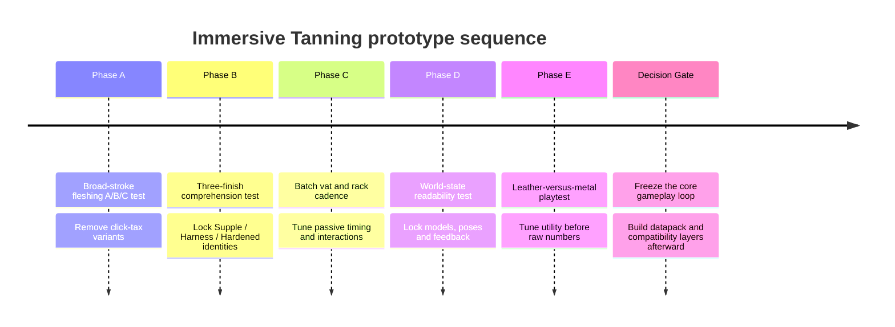

# Immersive Tanning: What Minecraft Mods and Survival RPGs Teach Us About Making Leather Matter

## Executive summary

The comparative research points to a fairly strong conclusion: **Immersive Tanning should not become a more accurate simulation of tanning. It should become a more expressive craft with fewer, more meaningful interactions.**

The most successful systems examined do one of two things well. Systems such as **TerraFirmaCraft** and **Vintage Story** make hide processing believable by giving it a visible physical journey, but their many intermediate states are appropriate to total-conversion survival games and would be too laborious for a focused sister mod. TerraFirmaCraft explicitly presents itself as a broad reinvention of survival, not a lightweight crafting addition. citeturn18search1turn18search2 At the opposite extreme, **Skyrim** reduces tanning to a single workstation conversion; it is readable and painless, but leather becomes an anonymous ingredient rather than a craft. citeturn22search0

The strongest lessons come from systems adjacent to tanning. **Tinkers' Construct** shows that a small number of clear material traits can create vastly more identity than adding process steps, and its developers have deliberately reduced part/stat complexity while retaining material differentiation. citeturn22search6turn22search18 **Valheim's** troll leather demonstrates how lighter hide armor can remain desirable beside heavier armor by possessing a recognizable gameplay identity instead of merely occupying a lower protection tier. citeturn15search14turn15search19 **Monster Hunter** demonstrates the enormous psychological value of preserving the identity of the creature in the resulting equipment: monster materials become trophies and build-defining resources rather than generic crafting currency. citeturn13search4turn13search16 **Don't Starve** accomplishes something similar more simply: Pig Skin has little processing complexity, yet remains memorable because it is attached to immediately useful, distinctive recipes such as the Football Helmet and Piggyback. citeturn22search1turn22search13turn22search33

For **Immersive Tanning**, I would therefore revise the previous design around five principles:

> **Two moments of skill. One strategic material choice. Batch everything passive. Show state physically. Make the resulting leather change how the player plays.**

That leads to a cleaner core loop:

**Raw Hide → Tanner's Rack: Flesh → Tanner's Vat: Tan → Tanner's Rack: Finish & Dry → Leatherworker's Bench: Cut & Stitch**

This is notably simpler than the earlier proposal. I recommend **removing the mandatory pre-soak as a separate stage, combining the Fleshing Beam and Drying Frame into one Tanner's Rack, abandoning tannin-strength chemistry, using bark directly instead of creating tannic powder, and eliminating a separate repair-kit item.** Those changes reduce the number of stations and intermediate concepts while preserving almost all of the tactile fantasy.

The three leather identities remain the strongest part of the original concept, but I would frame them as **finishes rather than tanning chemistries**:

| Finish | One-sentence identity | Primary reason to choose it |
|---|---|---|
| **Supple Leather** | Light, flexible leather worked for movement | Mobility / quietness |
| **Harness Leather** | Tough general-purpose leather | Durability / easy repair |
| **Hardened Leather** | Rigid protective leather | Protection |

There should be **no fourth mandatory dimension** such as tannin concentration, oil percentage, hide moisture, tanning duration, or species quality. Integrity answers *how well did you prepare it?*; Workmanship answers *how well did you make the item?*; Finish answers *what did you intend the leather to do?* That is enough.

The underlying Immersive Smithing design already provides the right philosophical precedent: two short player-skill interactions determine durability and efficacy, tool tiers give time rather than free quality, failures do not casually erase expensive material, datapacks drive compatibility, and automation handles inputs without performing craftsmanship. fileciteturn1file0L2-L2 Immersive Tanning should inherit those principles while **not copying Smithing's exact interaction structure**.

My strongest recommendation after this review is therefore:

> **Make tanning shorter than the original plan, but make leather deeper after it is finished.**
>
> The player should remember *what they chose to make*, not how many buckets they moved between vats.

## Comparative survey

The table below separates **interaction complexity** from **meaningful depth**. A system can be mechanically simple while producing a compelling decision, or mechanically elaborate while ultimately producing the same generic leather.

| Source | Interaction Type | Skill / Minigame | Time / Batching | Material Identity | Player Benefit | Complexity Level | Notable Lessons |
|---|---|---|---|---|---|---|---|
| **Immersive Smithing** fileciteturn1file0L2-L2 | Physical forge → anvil → quench workflow | Two short timing minigames | About a minute/item; passive inputs can automate | Metal families + two quality scores | Better durability/efficacy; recoverable material | **Moderate** | Excellent baseline: craftsmanship should affect output. **Risk:** copying its exact structure would make Tanning feel like Smithing with brown textures. |
| **TerraFirmaCraft** citeturn18search1turn18search2 | Multi-state hide processing; raw, soaked, scraped and prepared hide states before leather | Primarily procedural/manual transformation | Long-form survival process; hides vary by size | Hide size/state strongly represented | Leather is earned through believable processing | **High** | Excellent physical narrative. **Failure for this project:** too many intermediate states turn realism into inventory/workflow management. Appropriate for a total conversion; excessive for a focused craft mod. |
| **Butchercraft: Tannery** citeturn20view0turn20view1 | Place hide on rack, scrape with knife, let cure | Simple direct scraping | 60-second configurable cure | Raw → scraped → leather | Adds tactile step to Butchercraft | **Low** | Very strong economy of interaction: one physical action + one passive transition. **Risk:** mandatory sunlight and campfire placement can become a “why won't this work?” environmental puzzle rather than craftsmanship. |
| **Tannery: Better Leather** citeturn21search0 | Animal hides dry on racks, then combine with bark-derived tannic material in barrel | No substantial skill check | Passive drying + processing | Species hides plus hardened/studded leather | Satchels, armor, sinew and expanded leather uses | **Moderate** | Crucial insight: a longer process needs a richer **output ecosystem**. Hardened/studded leather makes processing worthwhile. **Risk:** many species hides, powders, byproducts and variants can create inventory bloat. |
| **Tinkers' Construct** citeturn22search6turn22search10turn22search18 | Materials become tool parts carrying stats/traits | Choice/build knowledge rather than reflex minigame | Immediate crafting once materials exist | Extremely strong: material determines recognizable traits | Build specialization and customization | **Moderate–High systemic depth; low per-action complexity** | Probably the most important non-tanning reference. One understandable trait can make a material interesting without adding another crafting step. Tinkers' own redesign reduced trait/part complexity while keeping identity. |
| **Vintage Story** citeturn18search8 | Size-based raw/soaked/scraped/prepared/tanned/oiled hide states; some hides cure over time | Mostly procedural | Strong use of passive curing | Hide size and processing state matter | Deep survival-production fantasy | **High** | Excellent workshop fantasy and visible material progression. **Refuse:** reproducing the entire state ladder would make Tanning a logistics system instead of a craftsmanship system. |
| **Skyrim** citeturn22search0turn22search16 | Tanning rack converts hides/pelts → leather → strips | None | Instant | Almost none after conversion | Fast access to ubiquitous crafting component | **Very low** | The rack is wonderfully legible and frictionless. But because source identity and craftsmanship disappear, tanning itself has practically no gameplay meaning. Useful **UX model**, poor depth model. |
| **Conan Exiles** citeturn16search5turn16search7 | Hide + bark in tannery; larger beasts provide thick-hide routes | Resource acquisition, not minigame skill | Workstation batch processing | Regular vs thick leather; creature source affects access | Higher-grade leather unlocks heavier equipment | **Moderate** | Bark ties leatherworking to the world naturally; thicker creatures producing stronger leather is intuitive. **Risk:** bark farming and separate tannery/table workflows can become production tax rather than interesting choice. |
| **Don't Starve / DST** citeturn22search1turn22search13turn22search33 | Creature material goes directly into recipes | None | Immediate | Very strong source identity: Pig Skin remains Pig Skin | Highly useful helmet, backpack and other recipes | **Low** | Processing depth is unnecessary when the material has memorable uses. Leather becomes worthwhile when it answers “what can I uniquely do with this?” rather than just “what armor tier is this?” |
| **Monster Hunter** citeturn13search4turn13search16turn13search3 | Monster materials are forged into specific equipment | Hunting skill supplies crafting; smithy itself is straightforward | Material gathering can be repeated; crafting direct | **Extremely strong** creature/equipment identity | Armor stats, skills, builds, visual trophies | **Low crafting complexity; high acquisition depth** | The material remembers where it came from. This makes the finished object emotionally meaningful. For modded fantasy hides, provenance is much more valuable than adding extra chemical stages. |
| **Valheim** citeturn15search14turn15search19 | Creature hides directly craft light armor | No crafting minigame | Immediate once gathered | Troll leather forms a recognizable light-armor route | Lower-burden armor with a Sneak-oriented identity | **Low** | A hide armor set need not beat metal at armor points to remain desirable. **Risk:** set-bonus thresholds can punish mixing pieces; benefits should preferably scale per piece. |

Two patterns stand out across almost every example.

First, **the processing systems that feel most believable are not necessarily the systems that make leather most desirable**. TFC and Vintage Story provide rich transformation stories, but the strongest arguments for *wearing* or *seeking* hides come instead from Valheim, Tinkers, Monster Hunter and Don't Starve. citeturn18search2turn15search19turn22search18turn22search13

Second, **material identity survives when it reaches the player's behavior**. A different icon or another intermediate item is weak identity. A leather that makes the player quieter, easier to repair, more mobile, or uniquely resistant to something is strong identity. Tinkers' material traits and Valheim's light-armor role are particularly instructive here. citeturn22search6turn22search22turn15search14

## What the comparisons imply for the core design

### Compress realism into gestures, not recipes

The earlier Immersive Tanning concept represented history by explicitly modeling soaking, fleshing, tanning and drying. The comparison suggests that one of those layers can disappear without losing the fantasy.

I recommend changing:

**Raw Hide → Soak → Flesh → Tan → Dry → Leatherwork**

to:

**Raw Hide → Flesh → Tan → Finish/Dry → Leatherwork**

The missing soak is not really missing experientially. The Tanner's Rack can show a damp hide being washed as it is mounted, while the opening stroke animation/sound implies the preparation work. The player understands *“I am cleaning and preparing a wet hide”* without having to create and carry an item named `Soaked Hide`.

That follows the best lesson of Butchercraft's rack: the player physically scrapes a hide and then watches it transform, with very little conceptual overhead. citeturn20view0 It also avoids importing TFC's numerous intermediate hide states into a mod whose core promise is short craftsmanship interactions rather than total-conversion survival logistics. citeturn18search1turn18search2

### Collapse the Beam and Frame into one Tanner's Rack

This is the biggest structural refinement I would make.

Instead of:

**Vat + Beam + Drying Frame + Leatherworker's Bench**

use:

**Tanner's Rack + Tanner's Vat + Leatherworker's Bench**

The **Tanner's Rack** performs two visually different jobs:

1. Raw hide mounts low/forward for fleshing.
2. Wet tanned hide mounts stretched vertically for finishing and drying.

That is not merely fewer blocks. It gives the workstation a lifecycle. Early in the process the player bends over it with a knife; later it becomes part of the scenery as completed hides hang and dry.

Both Skyrim and Butchercraft show how much readability a single recognizable rack can provide, while Butchercraft demonstrates that active scraping and passive curing can comfortably belong to the same physical object. citeturn22search0turn20view1

The workshop therefore remains visually rich—several racks filled with hides, a dark tannin vat, a bench with tools—but the player only needs to learn three workstation names.

### Move the strategic decision from chemistry to finishing

The earlier **Mild → Rich → Strong tannin strength** idea is the clearest concept I would now remove.

It introduces a variable, but not a particularly interesting decision. Unless recipes require the player to solve concentration puzzles, the optimal behavior will quickly become “keep the vat at the correct level.” At that point it is maintenance, not craftsmanship.

Conan demonstrates that **bark itself is already enough** to connect tanning to the surrounding world: hide and bark enter the tannery, and thicker animal hides lead to thicker leather. citeturn16search5turn16search7 Tannery: Better Leather similarly obtains bark from stripped wood before using it in leather processing. citeturn21search0turn21search10

So Immersive Tanning should use:

**Water + Bark + Scraped Hide → Wet Tanned Hide**

No tannic powder.

No concentration meter.

No weak/medium/strong solution.

No different bark math in the default experience.

The **meaningful decision happens afterward**, while mounting the wet hide on the rack:

> **How are you going to finish this leather?**

The player chooses one of three large, visually represented modes:

**Supple** — hide hangs relatively loose and is worked for flexibility.

**Harness** — hide is tensioned normally.

**Hardened** — hide is stretched taut into a rigid-looking profile.

Drying then happens passively.

This turns the treatment choice from abstract chemistry into something the player can **see from across the workshop**.

### Preserve three leather identities, but give each exactly one headline advantage

Tinkers' Construct is especially useful here. Its modern design moved toward a clearer model where a material generally has a more comprehensible trait role instead of proliferating material/part-specific traits, and its documentation exposes materials, stats and traits as data-driven concepts. citeturn22search6turn22search10

Immersive Tanning should follow that restraint.

**Supple Leather** should not simultaneously grant movement speed, attack speed, dodge distance, stamina efficiency, swimming speed, jump height and stealth. Its headline identity is:

> **Move freely and quietly.**

Implementation could mean a very small movement advantage plus reduced movement/footstep detection where compatible. The tooltip says **Light & Quiet**.

**Harness Leather** should not have six durability modifiers. Its identity is:

> **Lasts a long time and repairs exceptionally well.**

Its tooltip says **Rugged & Repairable**.

**Hardened Leather** should not attempt to simulate hardness, thickness, blunt absorption and projectile resistance independently. Its identity is:

> **Best leather protection.**

Its tooltip says **Protective**.

The exact numeric implementation can vary with compatibility handlers while the player-facing meaning remains constant.

### Let creature identity exist only when it creates gameplay

Tannery: Better Leather explicitly adds hides for several vanilla animals. citeturn21search0 That improves flavor, but copying the approach wholesale risks filling inventories with Cow Hide, Horse Hide, Sheep Hide, Goat Hide, Pig Hide, Wolf Hide, Deer Hide and dozens of modded equivalents that ultimately all become the same item.

Monster Hunter suggests a better boundary: preserve provenance when provenance has an actual **equipment identity**. Its forging economy is built around specific monster materials becoming recognizable equipment with associated stats and skills. citeturn13search4turn13search3

For vanilla animals, I would therefore retain the earlier **size model**:

**Small Hide / Medium Hide / Large Hide**

The entity source can exist internally as metadata, but the player need not sort twenty hide items.

Then expose one optional datapack concept:

```text
immersive_tanning:hide_traits
```

A modpack or integration could define:

```text
dragon_hide -> Heatproof
winter_wolf_hide -> Insulating
giant_bat_hide -> Lightweight
troll_hide -> Tough
serpent_hide -> Water-Resistant
```

Only hides with an explicitly registered trait preserve their identity into finished leather.

Most cows remain simply **Large Hide**.

A dragon remains **Dragon Hide — Heatproof**.

This produces Monster Hunter-style trophy identity without making the base game imitate Monster Hunter's entire material catalog.

### Make leather valuable after crafting, not merely during crafting

This is probably the most important lesson in the research.

Skyrim's tanning is painless but unimportant because the conversion ends in generic leather. citeturn22search0 Don't Starve does almost no processing at all, yet Pig Skin remains desirable because it makes useful, memorable equipment such as the Football Helmet and Piggyback. citeturn22search13turn22search33 Valheim similarly keeps lighter creature-hide equipment relevant by assigning it a gameplay role rather than merely positioning it as “armor before metal.” citeturn15search19

Therefore the payoff hierarchy for Immersive Tanning should be:

**distinctive use > quality numbers > process realism.**

A Fine Harness Leather Chestplate is worthwhile because it is extremely maintainable in the field.

A Fine Supple Leather Chestplate is worthwhile because it supports an agile/quiet playstyle.

A Fine Hardened Leather Chestplate is worthwhile because it gives surprisingly respectable protection without turning leather into iron.

Its craftsmanship score then makes *that identity better*.

That is much more compelling than spending two minutes tanning something whose only payoff is “Leather Chestplate, but +8% durability.”

## Prioritized refinements for Immersive Tanning

The recommendations below are ordered by expected design impact. Implementation difficulty is relative to the existing Immersive Smithing architecture, which already has synchronized minigames, quality NBT, compatibility detection and datapack-driven definitions. fileciteturn1file0L2-L2

| Priority | Refinement | Impact | Difficulty | Concrete Immersive Tanning implementation |
|---:|---|---|---|---|
| **1** | **Use three finishes as the single strategic choice** | Very high | Medium | Keep **Supple / Harness / Hardened**, selected when a wet tanned hide is mounted for drying. Three large icons and visibly different rack poses. No chemistry statistics. |
| **2** | **Reduce the system to three stations** | Very high | Medium | Merge Fleshing Beam + Drying Frame into **Tanner's Rack**. Final topology: Rack → Vat → Rack → Bench. This borrows the workstation economy of Butchercraft/Skyrim without adopting their lack of depth. citeturn20view0turn22search0 |
| **3** | **Keep exactly two active skill interactions** | Very high | Medium | Fleshing = continuous spatial gesture. Leatherworking = rhythmic stitching. Tanning and drying remain passive/batchable. This preserves Immersive Smithing's “two short skill checks” philosophy. fileciteturn1file0L2-L2 |
| **4** | **Make leather a horizontal alternative to metal** | Very high | Medium | Supple → mobility/quiet; Harness → durability/repair; Hardened → protection. Do not compensate by nerfing iron. Valheim's hide/metal tradeoff is the useful model. citeturn15search19 |
| **5** | **Make field repair a native property of leather** | High | Low–Medium | Remove the proposed Repair Kit item. Hold **Leather Scrap + Awl**, interact with damaged leather equipment, and repair it while preserving enchantments, finish and quality. Harness receives the best repair efficiency. |
| **6** | **Use broad-stroke fleshing rather than cell clearing or repeated clicks** | High | Medium | Hide has 3–5 broad visible flesh areas. Dragging the knife through them scores coverage and excessive re-working. No tiny target cells. No fixed number of mandatory clicks. |
| **7** | **Batch every passive stage** | High | Low–Medium | Vat accepts several scraped hides; multiple racks can dry concurrently. Large hides yield several leather units, limiting how often the minigame must be replayed. Conan-style workstation production is useful here, without its larger production chain. citeturn16search12 |
| **8** | **Show process state in the world before showing it in a GUI** | High | Medium | Raw/fleshed/wet/drying/finished hides have visibly different surfaces and poses. Vat liquid darkens when charged. Ready hides sag/settle and emit a subtle sound cue. GUI text is secondary. |
| **9** | **Use bark directly; remove tannic powder and concentration** | High | Low | Tanner's Knife on a valid log strips it and yields Bark. Vat consumes bark in simple charges. `#immersive_tanning:tannin_sources` lets packs substitute modded bark/tannins. Conan and Tannery: Better Leather show how intuitively bark connects forests to tanning. citeturn16search5turn21search0 |
| **10** | **Preserve animal provenance only when it grants a trait** | Medium–High | Medium | Base vanilla hides collapse into sizes. A datapack-defined `hide_trait` can preserve exceptional sources such as dragon/troll/reptile hides. One innate trait maximum by default. Inspired by Monster Hunter's strong source-to-equipment identity. citeturn13search4turn13search3 |
| **11** | **Turn failure into inferior craft, never erased material** | Medium–High | Low | Poor fleshing lowers Integrity. Poor stitching lowers Workmanship. Timeout completes at low score. Very poor cutting produces some Scraps but still returns most leather. No “your cow hide vanished” outcome. |
| **12** | **Let scraps repair directly instead of creating a sub-crafting tree** | Medium | Low | Cutting naturally generates Leather Scraps. Scraps are repair material and a tagged component for grips/bindings. Do not add Scrap → Patch → Repair Kit unless another mod specifically requests it. |
| **13** | **Make compatibility traits data-driven instead of hard-coded per armor mod** | Medium | Medium | `treatments`, `hide_traits`, `leatherwork_equipment`, `non_leatherwork_equipment`, and optional equipment-effect handlers. Tinkers' materials/modifiers/tags demonstrate the value of a data-defined extension surface. citeturn22search10turn22search2 |

### A better fleshing interaction

This deserves special emphasis because it is the stage most likely to become annoying after the novelty wears off.

Do not model “work” by requiring **more inputs**.

Model work by making **one input expressive**.

The hide can contain four or five broad, high-contrast regions of remaining flesh. Holding attack/use against the mounted hide enters a controlled scraping gesture. The player's cursor or view direction guides the blade across its surface.

Three variables are sufficient:

**Coverage** — did you clean the whole hide?

**Control** — did you remain on the intended surface?

**Overworking** — did you repeatedly scrape already-clean areas?

The player should be able to understand the outcome by looking at the hide itself.

There need not even be three visible meters during ordinary play. The server can score them internally into **Integrity**.

That is more tactile than Yanny-style repeated scraping, more forgiving than a hidden grid, and mechanically distinct from Immersive Smithing's timing games.

### A better finishing interaction

Finishing should **not become a third minigame**.

When Wet Tanned Hide is placed back on the Rack, three attachment points—or a tiny radial selector—represent:

**Loose / Worked → Supple**

**Normal → Harness**

**Taut → Hardened**

The hide physically changes posture.

The decision takes two seconds.

The consequences last for the entire useful life of the leather.

That is an excellent ratio of **decision significance to interaction complexity**.

### A cleaner leatherworking minigame

The earlier cutting-and-stitching idea is strong, but I would simplify it to make **stitching the scored skill** while cutting is presentation.

When a recipe is selected, panels appear on the bench and are automatically rough-cut from the leather. The player can physically drag the knife along one or two generous guide lines for animation and immersion, but **cutting accuracy need not become another independent score**.

Then stitching becomes the actual Workmanship check:

`● — ● — ● — ● — ●`

A marker or tightening loop advances along the seam; the player uses the Awl at each broad timing point.

Misses create visibly uneven stitches but do not abort the craft.

Different recipes change seam **shape and rhythm**, not rules.

Boots might have a short curved seam.

A chestpiece has a longer alternating seam.

A saddle has two broad loops.

That achieves variety without teaching another mechanic.

## Rewards, compatibility, and what should explicitly be refused

### The reward model should be immediately legible

A player inspecting leather equipment should not need to understand five hidden coefficients.

For example:

> **Fine Supple Leather Boots**  
> Integrity: 86  
> Workmanship: 91  
> **Supple — Light & Quiet**  
> Crafted by PlayerName

or:

> **Masterwork Harness Leather Chestplate**  
> Integrity: 96  
> Workmanship: 94  
> **Harness — Rugged & Repairable**

Numeric scores can remain subject to the same client-side preference philosophy as Immersive Smithing; its current client configuration already separates presentation options such as numeric quality scores and accessibility cues from server-side scoring. fileciteturn1file0L2-L2

The important information is the **word identity**.

### Avoid full-set cliffs

Valheim illustrates both the strength and weakness of armor-set identity. Current community data records its Troll Leather equipment as granting the Sneaky effect, and its light-armor role is a major part of why the set remains attractive. citeturn15search14turn15search19

But Immersive Tanning should probably **not** require four Supple pieces before anything happens.

Instead:

- each Supple piece contributes some of the effect;
- each Harness piece improves its own repair/durability properties;
- each Hardened piece provides its own defensive advantage.

A full set naturally amplifies the playstyle because all four pieces contribute, without a hidden threshold suddenly switching the build on.

That also makes modded mix-and-match armor much easier to support.

### Utility equipment should use the system without expanding the mod's scope

Don't Starve's Pig Skin is memorable partly because the material makes more than generic armor: the Football Helmet and Piggyback turn it into a useful resource for combat and carrying capacity. citeturn22search13turn22search33 Tannery: Better Leather similarly ties its expanded leather chain to satchels and additional armor. citeturn21search0

Immersive Tanning does **not** therefore need to become a backpack mod.

Instead its datapack/compatibility layer should make these obvious leatherworking targets:

**saddles, quivers, backpacks, belts, gloves, scabbards, harnesses and modded leather shields.**

When such items exist in the pack, their recipes can route through Leatherworking.

The value comes from making the broader mod ecosystem feel like it uses leather craftsmanship—not from shipping a mediocre clone of every leather utility item itself.

### Exotic hides are an expansion vector, not a launch requirement

Monster Hunter's materials provide the strongest argument for eventual exotic hides. Specific materials are required to forge equipment, and the equipment's statistics/skills preserve a connection to what was hunted. citeturn13search4turn13search16

For Immersive Tanning, one optional innate trait per exceptional hide is enough:

| Exotic trait | Example effect | Best interaction with finishes |
|---|---|---|
| **Heatproof** | Reduced fire/heat vulnerability | Hardened defensive gear |
| **Insulating** | Cold resistance integration | Supple exploration gear |
| **Lightweight** | Reduced movement burden | Supple |
| **Tough** | Durability bonus | Harness |
| **Water-Resistant** | Rain/wet-system integration | Harness/Supple |

Crucially, a trait is **not a fourth crafting choice**. It comes from the creature.

The player chooses only the finish.

Thus:

> **Dragon Hide** provides *Heatproof*.  
> The player decides whether that Dragon Hide becomes **Supple**, **Harness**, or **Hardened**.

That creates combinatorial depth for modpacks without adding another screen to the process.

### Explicit refusals

The following mechanics should be rejected even when they are realistic or appear in adjacent survival systems. They are not inherently poor designs; they are simply poor fits for **Immersive Tanning's intended scope**.

| Refuse | Why |
|---|---|
| **Mandatory salt → lime → scrape → wash → tannin → oil chains** | TerraFirmaCraft/Vintage Story can sustain long production chains because their entire survival experience is built around them. Immersive Tanning would become disproportionately tedious. citeturn18search1turn18search8 |
| **A tannin concentration minigame** | Adds optimization/maintenance without adding an interesting character-build decision. |
| **Tannic Powder as an intermediate** | Bark already communicates the resource relationship. Powder adds inventory and recipe clicks, not meaningful choice. Compare the direct bark logic in Conan. citeturn16search5 |
| **Mandatory sunlight/campfire placement rules** | Butchercraft uses this effectively for flavor, but in a general-purpose mod it can turn a visually valid tannery into a troubleshooting exercise. citeturn20view0 |
| **Per-animal vanilla hide items** | Flavor does not justify inventory fragmentation unless species changes gameplay. |
| **Click the hide N times** | Repetition is not skill. One controlled gesture should replace many identical clicks. |
| **Hidden scraping cells** | Encourages pixel hunting rather than reading the hide. |
| **Hide spoilage** | Creates anxiety and inventory management without making the actual craft more satisfying. |
| **Hours of real-time tanning** | Passive work should create workshop rhythm, not schedule the player's evening. |
| **Random finished quality** | Contradicts the craftsmanship premise inherited from Immersive Smithing. |
| **Destroyed hide on minigame failure** | Makes practice feel economically punitive and encourages players to bypass the system. |
| **Five leather stat axes** | Tinkers' simplification work is a useful warning: more stat categories do not automatically produce more meaningful choice. citeturn22search6 |
| **Leather that is simply weaker iron** | The entire process becomes optional busywork once metal is available. Valheim demonstrates why a distinct light-armor role is stronger. citeturn15search19 |
| **Powerful full-set-only bonuses** | Creates a cliff and discourages compatibility/mix-and-match equipment. |
| **A new backpack/quiver/RPG system just to justify leather** | Compatibility should let existing mods provide those use cases. Keep Immersive Tanning focused on craftsmanship. |

The real-world process itself supports this abstraction. Leather manufacture contains preparation, tanning and finishing as conceptually distinct phases, while different finishing operations alter the resulting material; bark is a traditional source of vegetable tannins. citeturn21search1turn16search30 The game therefore does not need to model every chemical sub-step to honestly communicate **prepare → stabilize → finish**.

## Prototype program and success criteria

Before building the complete mod, five small prototypes can answer nearly every important design question.

### Broad-stroke fleshing test

Build only a rack, one hide texture and the gesture detector.

Test three interaction variants:

**A:** click individual dirty areas.  
**B:** hold and drag freely across broad regions.  
**C:** drag along suggested directional strokes.

The hypothesis is that **C or B will feel more like craftsmanship while becoming faster with mastery**, whereas A becomes a cleanup checklist.

Success criteria:

| Metric | Target |
|---|---:|
| Players understand what to do without written instructions | **≥ 80%** |
| Median completion time after three attempts | **6–12 seconds** |
| Experienced players outperform first attempt noticeably | **≥ 15 score points** |
| Players willing to flesh eight hides consecutively | **≥ 75%** |
| Mean “felt repetitive” score after eight hides | **≤ 2.5 / 5** |

The critical metric is not whether players can complete it. It is whether attempt eight still feels like *working a hide* rather than clearing a UI.

### Three-finish comprehension test

Present players with only:

**Supple — Light & Quiet**  
**Harness — Rugged & Repairable**  
**Hardened — Protective**

Then give scenarios:

> Exploring for several days far from home.

> Sneaking through a dangerous structure.

> Fighting a boss where damage reduction matters most.

> Using a modded backpack that takes durability damage.

Success should mean **≥90% of players can select a reasonable finish for each scenario without opening a guide**.

Also watch distribution. Across mixed scenarios, no one finish should receive more than roughly **70% of all choices**. If Hardened wins everything, leather still has a linear hierarchy rather than alternatives.

### Batch-cadence prototype

Prototype one vat holding four hides and four racks.

Compare:

**single-hide sequential workflow**

against

**batch vat + parallel drying**

The desired result is a tannery that encourages the player to start a batch, leave, do other work, and return to visibly changed stations.

Success criteria:

| Metric | Target |
|---|---:|
| Mandatory active interactions per hide outside minigames | **≤ 4** |
| Times player must reopen the same GUI per batch | **≤ 2** |
| Four hides can progress concurrently | **Yes** |
| Passive processing forces player to stand nearby | **Never** |
| “I was waiting for the game” responses | **< 20%** |

A very important result may be that **the Vat needs no traditional GUI at all** beyond optional JEI/Jade-style information.

### Leather-versus-metal choice test

This is the most important balance prototype.

Give testers equivalent-access gear choices in three scenarios:

**Dungeon assault** — raw defense matters.

**Long expedition** — durability and field repair matter.

**Stealth/exploration** — movement and quietness matter.

Then offer good-quality Hardened, Harness and Supple leather against comparable metal gear.

A healthy distribution would look roughly like:

| Scenario | Desired result |
|---|---|
| Raw defensive combat | Metal/Hardened dominate |
| Long expedition | Harness meaningfully competitive |
| Stealth/mobility | Supple meaningfully competitive |
| All scenarios combined | No option universally dominant |

The success criterion is **not** a 50/50 leather/metal split.

The success criterion is that testers can answer:

> “Why would I wear leather even though I have iron?”

with a gameplay reason rather than:

> “Because I like how it looks.”

If they cannot, more tanning mechanics will not fix the design.

### World-state readability test

Show testers screenshots or a test workshop from several blocks away without opening any interface.

Ask them to identify:

**raw hide / fleshed hide / tanning vat working / wet hide / drying hide / finished hide**, and distinguish the three finishing poses.

Targets:

**≥90% process-state recognition** after one tutorial exposure.

**≥80% finish recognition** from rack posture/icon alone.

Test a high-contrast/colorblind presentation too. Immersive Smithing already treats presentation/accessibility separately from scoring, which is the right model to retain. fileciteturn1file0L2-L2



The sequence matters. There is little value building broad compatibility for three treatment types until players actually perceive those treatments as interesting choices.

## Recommended final design and prioritized sources

Taken together, the research suggests a tighter version of Immersive Tanning than the first proposal.

The recommended release loop is:

> **Hunt → Flesh → Tan → Choose Finish → Make → Maintain**

Or physically:

**Raw Hide**

↓ place on **Tanner's Rack**

**Fleshing minigame**  
Broad strokes → **Integrity**

↓

**Scraped Hide**

↓ batch into **Tanner's Vat** with Water + Bark

**passive tanning**

↓

**Wet Tanned Hide**

↓ return to **Tanner's Rack**

Choose:

**Supple / Harness / Hardened**

↓ passive, visibly different drying

**Finished Leather**

↓ **Leatherworker's Bench**

Select equipment → **Stitching minigame** → **Workmanship**

↓

**Finished equipment**

whose long-term identity is:

**Integrity + Workmanship + Finish [+ optional exotic Hide Trait]**

That last bracket is important. The basic system is three-dimensional. Modpacks can make it four-dimensional without forcing that complexity on ordinary players.

Compared with the earlier design, this version removes:

**one workstation, one mandatory processing state, one resource intermediate, one chemistry variable, one proposed repair item, and most reasons for species-specific vanilla hide stacks.**

Yet it arguably adds more meaningful depth because the final leather is more differentiated.

The result would also distinguish Immersive Tanning cleanly from Immersive Smithing. Smithing's fantasy is **control under heat and impact**. fileciteturn1file0L2-L2 Tanning's fantasy becomes **careful preparation followed by deliberate material specialization**.

That is the difference worth protecting.

### Sources to prioritize during implementation

| Priority | Source | Why it deserves continued attention |
|---|---|---|
| **Essential** | [Immersive Smithing repository](https://github.com/otectus/Smithing) fileciteturn1file0L2-L2 | Architectural baseline: quality model, short minigames, server authority, datapacks, compatibility, accessibility and non-destructive material philosophy. |
| **Essential** | [Tinkers' Construct official documentation](https://slimeknights.github.io/docs/) citeturn22search10turn22search6 | Best reference for creating strong material identity while keeping extension APIs/data-driven content manageable. Its simplification of traits is directly relevant. |
| **Essential** | [Butchercraft: Tannery source](https://github.com/Trollmonkey/butchercraft_tannery) citeturn20view1 | Most direct Minecraft example of the “mount hide → physically scrape → passive cure” interaction. Excellent reference for a compact rack workflow. |
| **Essential** | [TerraFirmaCraft](https://www.curseforge.com/minecraft/mc-mods/terrafirmacraft) citeturn18search1turn18search2 | Best positive and negative comparator for process immersion: borrow its material journey, deliberately reject its full number of intermediate states. |
| **High** | [Monster Hunter official manuals](https://game.capcom.com/manual/MH4U/en/page-71.html) citeturn13search4turn13search16 | Best conceptual model for future exotic hides: materials should preserve the identity of the creature and create equipment people actually pursue. |
| **High** | [Tannery: Better Leather](https://www.curseforge.com/minecraft/mc-mods/tannery-better-leather) citeturn21search0 | Useful recent specialized comparator for racks, barrels, bark, differentiated leather and utility outputs; also useful as a warning against unnecessary item proliferation. |
| **High** | [Skyrim tanning documentation at UESP](https://en.uesp.net/wiki/Skyrim:Tanning) citeturn22search0 | Strong reference for workstation legibility and near-zero-friction conversion. Useful for asking how little UI the Vat/Rack really need. |
| **High** | [Don't Starve Pig Skin documentation](https://dontstarve.wiki.gg/wiki/Pig_Skin) citeturn22search1turn22search13turn22search33 | Strong demonstration that a hide becomes memorable through desirable recipes and creature identity rather than processing complexity. |
| **High** | [Conan Exiles community documentation / Funcom forums](https://forums.funcom.com/t/where-to-find-some-special-items/103541) citeturn16search5turn16search7 | Particularly useful for bark-as-tanning-resource, batch stations and ordinary/thick leather progression—and as a warning about grind and station proliferation. |
| **High** | Valheim current equipment data and community documentation citeturn15search14turn15search19 | Best reference here for the central balance question: how lower-defense creature-hide armor can remain a deliberate alternative to heavier armor. |
| **Secondary** | [Vintage Story Survival Handbook](https://wiki.vintagestory.at/Survival_Handbook) citeturn18search8 | Excellent inspiration for workshop atmosphere, hide states and curing, but intentionally too detailed to copy wholesale. |

The design lesson across those sources is remarkably consistent once process complexity and player value are separated:

> **Do not spend complexity proving that tanning is complicated. Spend complexity proving that leather is interesting.**

The process should be tactile enough that a hide feels transformed by the player's hands. The result should be strategically distinct enough that, when a player has iron in a chest and still deliberately walks over to the tannery, **the mod has succeeded**.